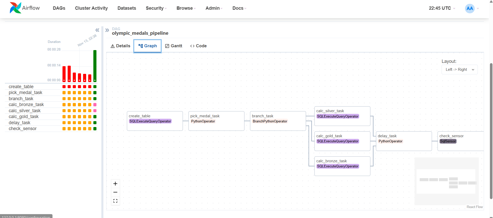
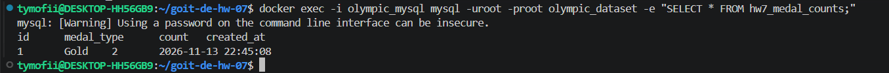
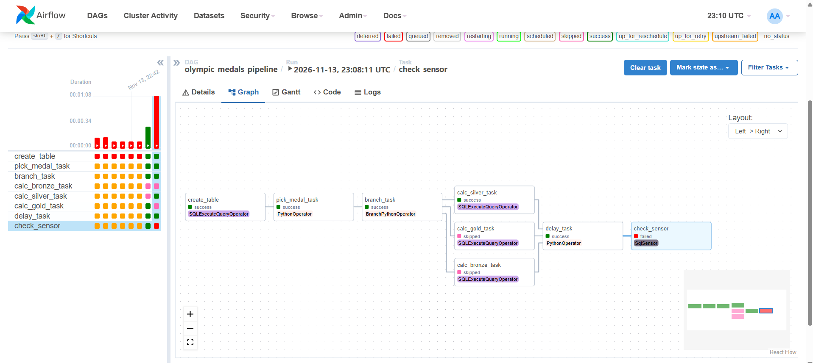

# GoIT Data Engineering - Домашнє завдання 7

## Опис проєкту

Цей репозиторій містить виконання 7-го домашнього завдання, присвяченого оркестрації даних за допомогою Apache Airflow.

Головна мета: створення автоматизованого конвеєра (DAG), який обирає тип медалі (Gold, Silver, Bronze), рахує їх кількість у базі даних MySQL за допомогою умовного розгалуження, зберігає результат у нову таблицю та перевіряє успішність запису за допомогою SQL-сенсора.

## Архітектура проєкту

- `dags/olympic_medals_dag.py` — основний скрипт із логікою конвеєра (DAG).
- `docker-compose.yaml` — конфігурація для локального підняття Airflow та бази даних MySQL.
- `screenshots/` — каталог із результатами виконання завдань.

## Процес виконання та результати

### 1. Успішний запуск конвеєра

Після налаштування графа та розгалуження, DAG успішно відпрацював. Завдання випадковим чином обрало гілку підрахунку, застосувало затримку в 10 секунд і пройшло перевірку сенсором. Інші гілки були коректно пропущені.

### 2. Перевірка запису в базі даних

Перевірка через термінал підтвердила, що дані були коректно збережені в таблицю `hw7_medal_counts` (записано тип медалі, кількість та час створення).

### 3. Тестування таймауту сенсора

Для перевірки роботи сенсора штучну затримку перед його запуском було збільшено до 35 секунд. Сенсор не дочекався нового запису в межах ліміту (30 секунд) і завершився зі статусом failed.

## Розв'язання проблем (Troubleshooting)

Під час налаштування середовища було вирішено такі інфраструктурні завдання:
1. **Права доступу до логів:** надано повні права доступу локальним папкам (chmod -R 777), щоб Airflow у Docker міг коректно записувати логи.
2. **Підключення до БД:** в Airflow UI налаштовано Connection (вказано хост olympic_mysql, пароль та схему olympic_dataset).
3. **Ініціалізація даних:** створено таблицю athlete_event_results із тестовими даними безпосередньо через термінал, оскільки використовувався чистий образ MySQL.